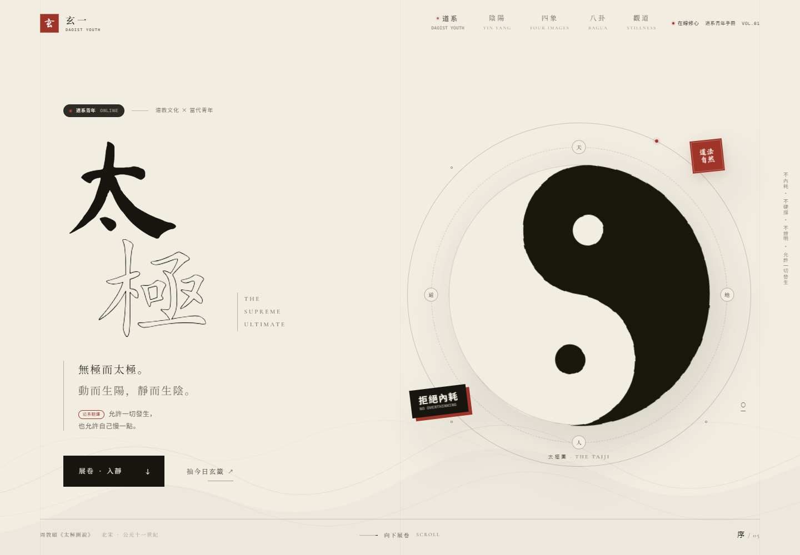
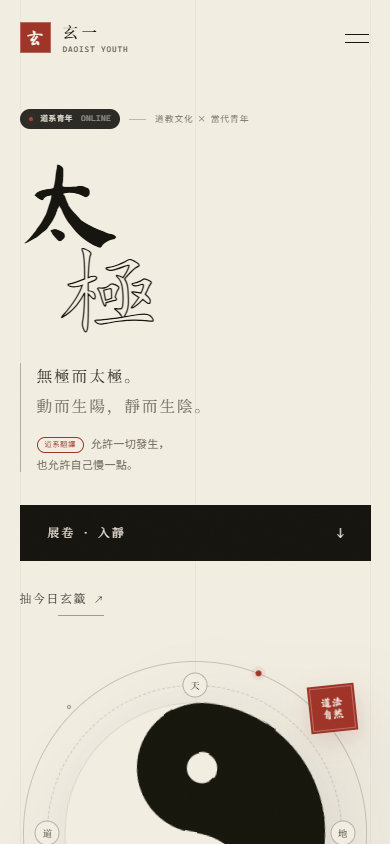

# 玄一 · 太極｜道系青年

中国古风黑白太极主题单页，正在修一种很新的仙。以宣纸、墨色与朱砂为视觉骨架，把道教文化翻译成当代年轻人的生活语气：不内耗、松弛感、人间清醒，以及一颗会呼吸的太极。

**在线体验：** https://opes32.github.io/xuan-yi-taiji/

**GitHub 仓库：** https://github.com/OPES32/xuan-yi-taiji






## 预览

直接双击打开 `index.html` 即可，无需构建、无需联网。也可以在目录内启动一个静态服务器：

```powershell
python -m http.server 8787
```

然后访问 `http://127.0.0.1:8787/`。

## 设计方向

- **古风为骨**：宣纸、墨色、朱砂、竖排书法、太极轨道与篆意印章。
- **当代为皮**：新中式 Bento 网格、圆角卡片、实时在线标签、等宽字体微文案、票据式抽签卡。
- **内容翻译**：用「道系翻译」注脚把《道德经》与《太極圖說》转译成今天的情绪与生活场景。
- **轻交互**：不制造焦虑的抽签、可横向滑动的卡片、4-7-8 呼吸引导，以及缓慢旋转的太极。

## 页面结构

- **卷首 · 太極**：书法标题、带鼠标视差的旋转太极图、道系青年徽标与拒绝内耗贴纸。
- **序 · 道系青年**：现代排版 manifesto、三张「鬆弛感 / 反內耗 / 人間清醒」卡片，以及可摇动的「玄門日籤」。
- **壹 · 陰陽**：左右黑白分割面板，悬停时互相扩张；中央太极作为分割扣件。
- **貳 · 四象**：少陽 / 太陽 / 少陰 / 太陰四张季节卡片，悬停反色，季节大字作为纸面暗纹。
- **參 · 八卦**：可点击、可悬停的八卦星盘；中央太极与环形篆意文字缓慢旋转，左侧象意随卦更新。
- **肆 · 觀道**：4-7-8 呼吸引导圆环，点击「息」开始或停止，并显示呼吸阶段与倒计时。
- **卷末**：回归页首的留白式页脚。

每个传统章节末尾都有一枚「道系翻譯 / MODERN NOTE」，把古典句子接回具体生活。

## 交互与动效

- **玄門日籤**：按日期生成初始签文；点击「摇一支新籤」可随机更换，每次仅供自省。
- **横向卡片**：移动端三张道系卡片可左右滑动，带 scroll-snap 与滑动提示。
- 尊重 `prefers-reduced-motion`，减少动态时关闭旋转、视差、抖动与入场动画。
- 支持键盘操作：菜单焦点圈定、`Esc` 关闭菜单、八卦节点 `focus` 更新象意。
- 移动端全屏卷目菜单，含焦点管理、背景 `inert` 与滚动锁定。
- 顶部阅读进度、章节导航高亮、滚动渐显。
- 所有字体、纹样、图形均在本地，无第三方脚本、无外部请求。

## 自定义

视觉变量集中在 `css/style.css` 的 `:root`：

```css
--paper: #f2ede1;   /* 宣纸 */
--ink: #15140f;     /* 墨色 */
--seal: #9e3226;    /* 朱砂 */
--font-sans: "Noto Sans SC", ...;  /* 当代层 */
```

- 八卦数据位于 `js/main.js` 的 `trigrams` 数组，可替换卦名、英文名、象意与爻线。
- 呼吸节奏位于 `breathPhases` 数组中的秒数。
- 日签文案位于 `oracleEntries` 数组，可自由替换「宜 / 忌 / 今日一句」。
- 新章节文案集中在 `index.html` 的 `.section--dao` 区块。

## 文件

```
taiji/
├── index.html
├── css/
│   ├── style.css
│   └── fonts.css
├── js/
│   └── main.js
├── assets/
│   ├── favicon.svg
│   ├── noise.svg
│   └── fonts/
├── preview/
│   ├── desktop.png
│   ├── mobile.png
│   └── dao.png
└── README.md
```

字体：Ma Shan Zheng、Noto Serif SC、Noto Sans SC、Cormorant Garamond，均为 SIL Open Font License 字体，详见 `assets/fonts/FONT-LICENSES.md`。
